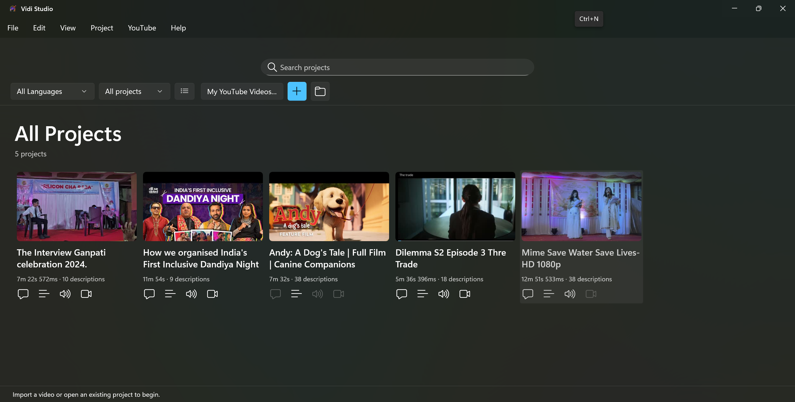
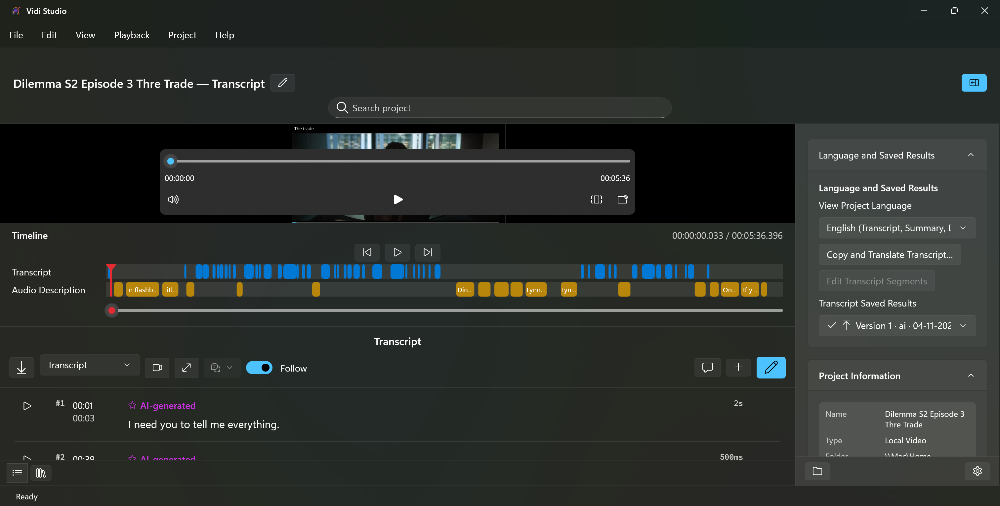
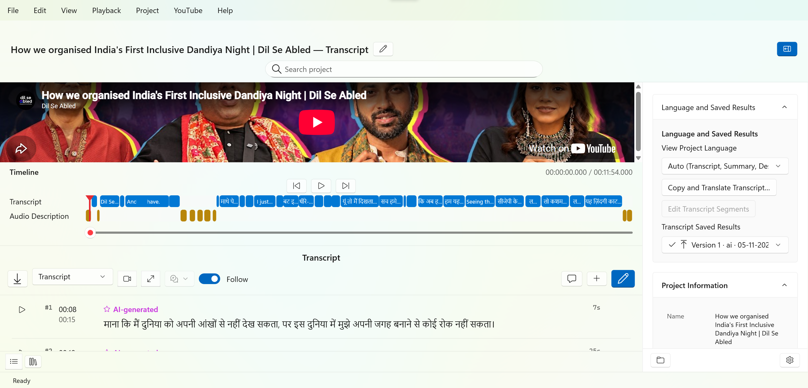
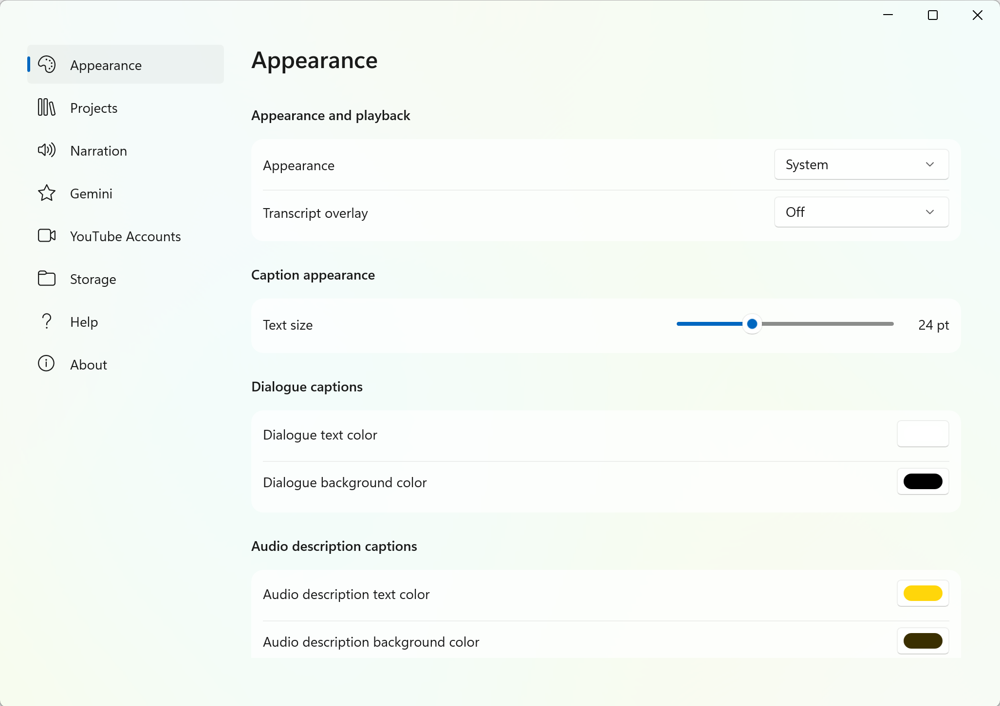
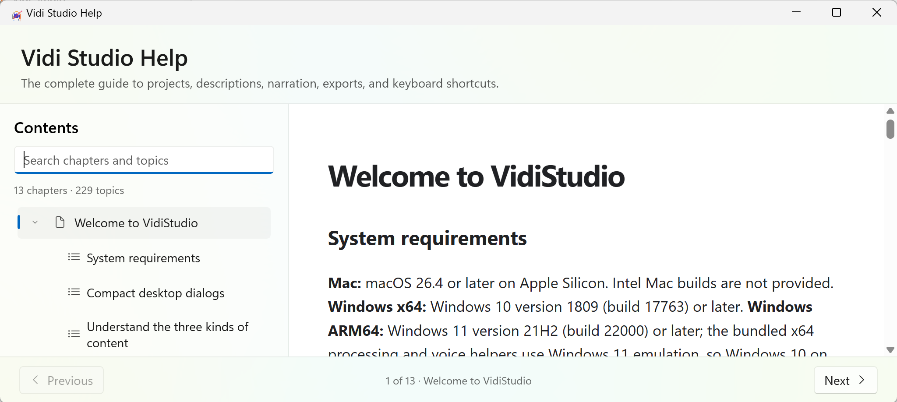

# Vidi Studio Microsoft Store assets

## Store packages

Use a staged copy of the desktop workspace. In the Windows copy, run `script/set-store-manifest.ps1` with the staged manifest path, package name, publisher and publisher display name from Partner Center's Product Identity page. Then run `script/build-windows.ps1 -Package -Configuration Release -Store -Platform ARM64` and repeat for x64.

The Store packages use Windows' default registry and AppData isolation. They declare the Windows 11 context menu, Open with, Share and browser handoff in the manifest. Edge and Chrome extensions update through their browser stores. Legacy registry repair and the unpacked browser updater run in the direct-download and development builds. Inspect the final manifests before uploading and confirm that Partner Center shows both architectures with no request for `unvirtualizedResources`.

## Desktop screenshots

### All Projects · Dark mode

### Local video editor · Dark mode

### YouTube project editor · Light mode

### Appearance settings · Light mode

### Help · Light mode

## App icons

| 300 × 300 | 150 × 150 | 71 × 71 |
| --- | --- | --- |
|  |  |  |
